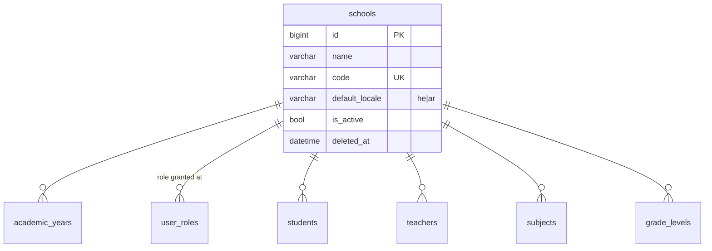
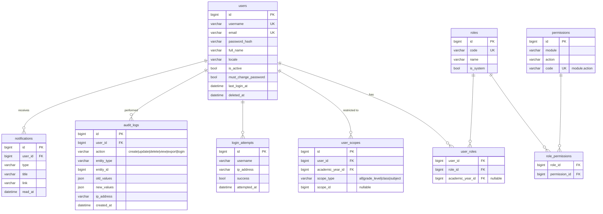
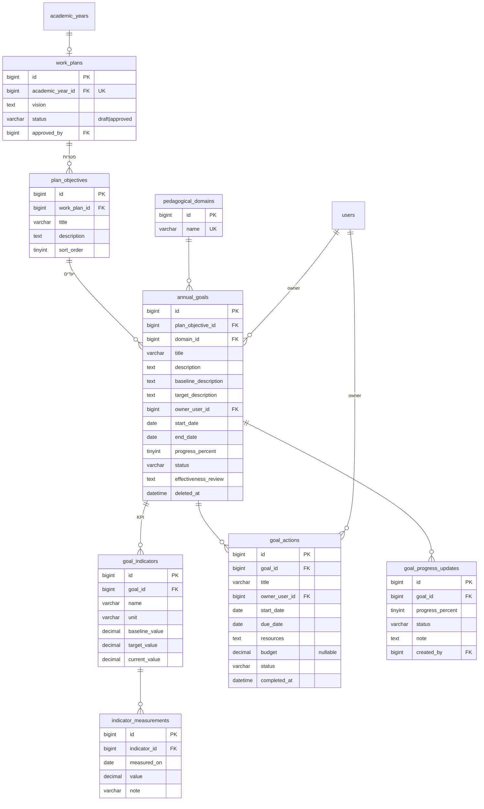
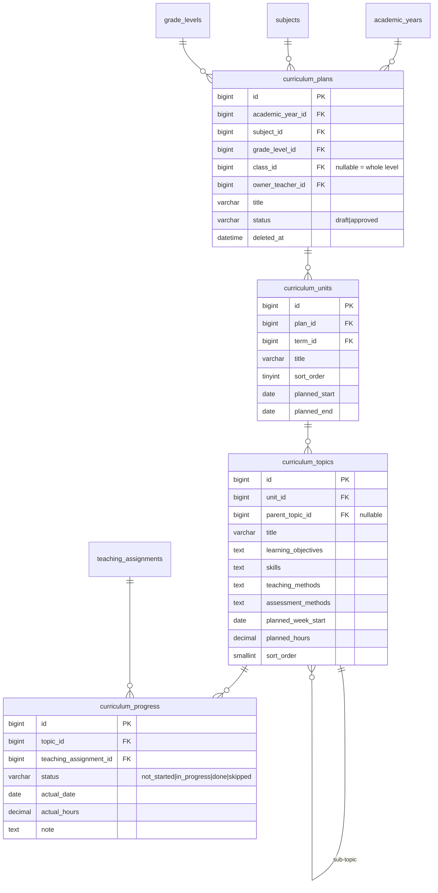
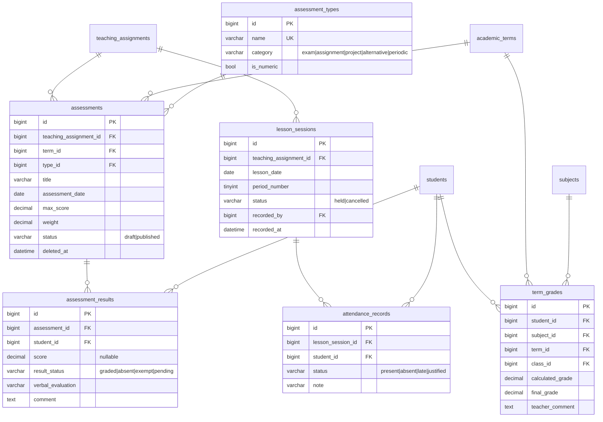
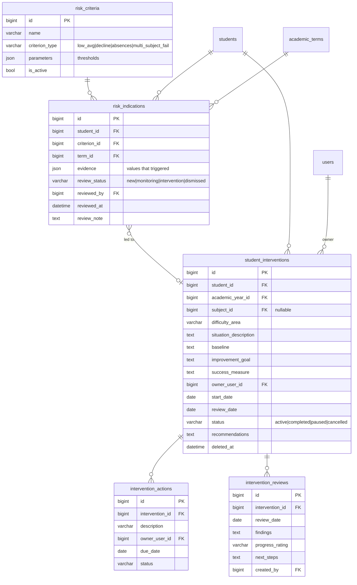
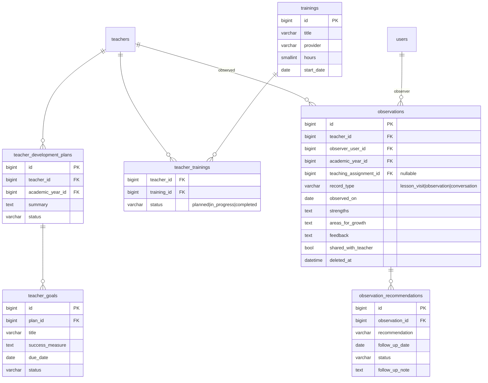
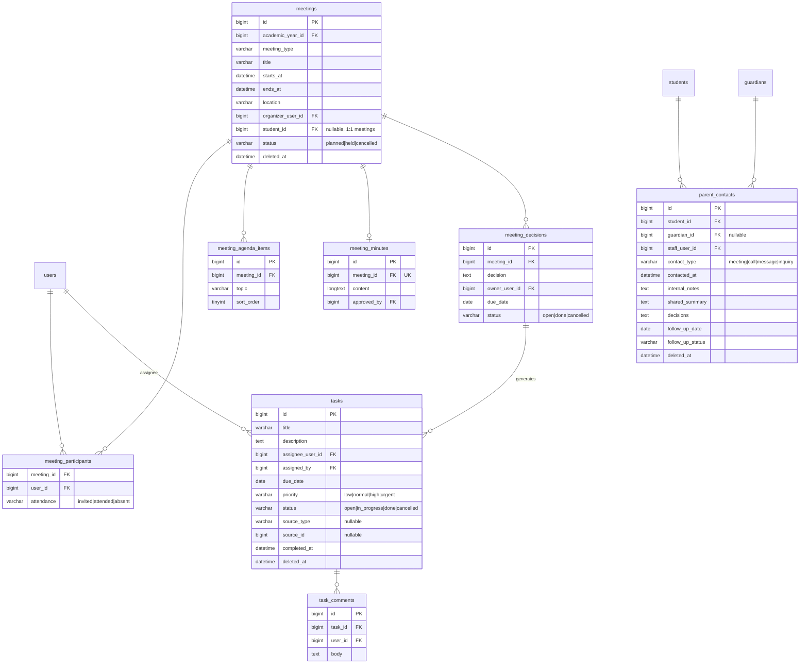
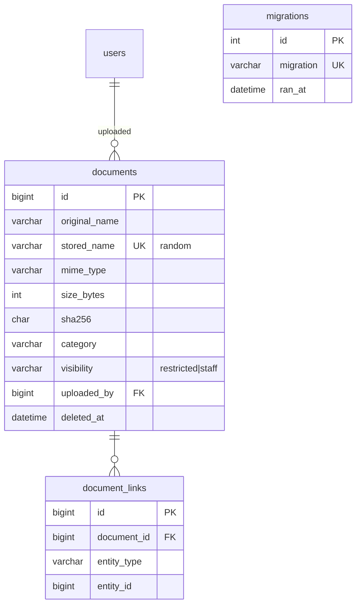

# SPMS – מבנה מסד הנתונים (ERD)

גרסה 0.1 · נלווה ל-[01-specification.md](01-specification.md)

## מוסכמות

- מנוע InnoDB, קידוד `utf8mb4` (collation: `utf8mb4_unicode_ci`).
- מפתח ראשי `id BIGINT UNSIGNED AUTO_INCREMENT` בכל טבלה.
- `created_at`, `updated_at` בכל טבלה; `created_by`, `updated_by` (FK ל-`users`) בטבלאות תוכן.
- **Soft delete** (`deleted_at`) בטבלאות המסומנות ב-🗑; בשאר – מחיקה אמיתית או אי-מחיקה (יומנים).
- **הפרדת שנים:** טבלאות המסומנות ב-📅 נושאות `academic_year_id` (ישירות או דרך אב), וכל שאילתה מסוננת לפיו.
- סטטוסים וסוגים נשמרים כ-`VARCHAR` עם רשימת ערכים סגורה בקוד (ולא `ENUM`), כדי לאפשר הרחבה ללא שינוי סכימה.
- הערה לשמות: הדרישה מציינת `grades` לשכבות. בחרתי **`grade_levels`** כדי למנוע בלבול עם "grades" במובן ציונים.

סה"כ 66 טבלאות בתשעה תחומים.

---

## 0. ריבוי בתי ספר (הוחלט: רשת)

**כללי הבידוד בין בתי ספר**
- 🏫 **`school_id NOT NULL` ישיר** בטבלאות השורש: `academic_years`, `grade_levels`, `subjects`, `rooms`, `teachers`, `students`, `guardians`, `school_settings`, `assessment_types`, `pedagogical_domains`, `risk_criteria`, `trainings`, `tasks`, `documents`, `notifications`, `audit_logs`. בתרשימים שבהמשך העמודה אינה מצוירת שוב, אך היא קיימת.
- **עדכון שלב ד (החלטות D27, D34):** `term_grades`, `attendance_summaries` ו-`indicator_measurements` לא נוצרו – הנתונים מחושבים מהרשומות. הסכימה בפועל נמצאת ב-`database/migrations/`, והיא הקובעת.
- **עדכון שלב ג (החלטה D17):** גם טבלאות-הבת של מבנה בית הספר (`academic_terms`, `classes`, `class_enrollments`, `teaching_assignments`, `teacher_subjects`, `staff_positions`, `calendar_events`) נושאות `school_id`, כדי שהקשרים ביניהן יהיו מפתחות זרים מורכבים. הכלל יחול גם על הטבלאות של השלבים הבאים.
- אילוצי הייחודיות בטבלאות השורש הם **לכל בית ספר**: `UNIQUE(school_id, name)`, `UNIQUE(school_id, student_code)` וכו' (המסומן `UK` בתרשימים).
- `users` גלובלית (אדם אחד יכול לעבוד בשני בתי ספר); השיוך נעשה ב-`user_roles(user_id, role_id, school_id, academic_year_id)`. `school_id = NULL` שמור לתפקידי רשת (מנהל מערכת, מפקח רשת).
- `roles`: תפקידי המערכת גלובליים (`school_id NULL`); תפקיד מותאם שבית ספר יוצר נושא את ה-`school_id` שלו.
- **אכיפה:** בית הספר הפעיל נשמר ב-session לאחר ההתחברות; `ScopedRepository` מוסיף `school_id = ?` לכל שאילתה, ו-FK מורכבים `(school_id, id)` בקשרים בין טבלאות שורש מונעים ברמת המסד קישור תלמיד של בית ספר א' לכיתה של בית ספר ב'. לכל מודול תיכתב בדיקת "דליפה בין בתי ספר".

---

## 1. זהות, הרשאות וביקורת

**קשרים מרכזיים**
- משתמש ↔ תפקיד: רבים-לרבים. שיוך יכול להיות תלוי-שנה (מחנך השנה אינו בהכרח מחנך בשנה הבאה).
- `user_scopes` מוסיף היקף ידני מעבר להיקף הנגזר אוטומטית מ-`teaching_assignments` ומ-`classes.homeroom_teacher_id`.
- `audit_logs` לקריאה והוספה בלבד; אין לו עדכון או מחיקה דרך היישום.

---

## 2. מבנה בית הספר

```mermaid
erDiagram
    academic_years ||--o{ academic_terms : ""
    academic_years ||--o{ classes : ""
    grade_levels ||--o{ classes : ""
    classes ||--o{ class_enrollments : ""
    students ||--o{ class_enrollments : ""
    students ||--o{ student_guardians : ""
    guardians ||--o{ student_guardians : ""
    teachers ||--o| users : "login (optional)"
    teachers ||--o{ teaching_assignments : ""
    classes ||--o{ teaching_assignments : ""
    subjects ||--o{ teaching_assignments : ""
    teachers ||--o{ staff_positions : ""
    teachers ||--o{ teacher_subjects : ""
    subjects ||--o{ teacher_subjects : ""
    academic_years ||--o{ calendar_events : ""

    school_settings {
        bigint id PK
        varchar setting_key UK
        text setting_value
    }
    academic_years {
        bigint id PK
        varchar name UK
        date start_date
        date end_date
        bool is_current
        bool is_locked
    }
    academic_terms {
        bigint id PK
        bigint academic_year_id FK
        varchar name
        tinyint sort_order
        date start_date
        date end_date
    }
    grade_levels {
        bigint id PK
        varchar name UK
        tinyint level_number
    }
    classes {
        bigint id PK
        bigint academic_year_id FK
        bigint grade_level_id FK
        varchar name
        bigint homeroom_teacher_id FK
        bigint room_id FK
        datetime deleted_at
    }
    subjects {
        bigint id PK
        varchar name UK
        varchar code
        bool is_active
    }
    rooms {
        bigint id PK
        varchar name UK
        smallint capacity
    }
    teachers {
        bigint id PK
        bigint user_id FK "nullable, UK"
        varchar first_name
        varchar last_name
        varchar staff_code UK
        varchar phone
        bool is_active
        datetime deleted_at
    }
    teacher_subjects {
        bigint teacher_id FK
        bigint subject_id FK
    }
    staff_positions {
        bigint id PK
        bigint teacher_id FK
        bigint academic_year_id FK
        varchar position_type
        bigint grade_level_id FK "nullable"
        bigint subject_id FK "nullable"
        text responsibilities
    }
    students {
        bigint id PK
        varchar student_code UK "internal id"
        varchar first_name
        varchar last_name
        char gender "nullable"
        date birth_date "nullable"
        varchar status "active|left|graduated"
        datetime deleted_at
    }
    guardians {
        bigint id PK
        varchar full_name
        varchar phone
        varchar email
    }
    student_guardians {
        bigint student_id FK
        bigint guardian_id FK
        varchar relation
        bool is_primary
    }
    class_enrollments {
        bigint id PK
        bigint student_id FK
        bigint class_id FK
        date enrolled_on
        date left_on "nullable"
    }
    teaching_assignments {
        bigint id PK
        bigint academic_year_id FK
        bigint teacher_id FK
        bigint class_id FK
        bigint subject_id FK
        decimal weekly_hours
        varchar group_name "nullable"
    }
    calendar_events {
        bigint id PK
        bigint academic_year_id FK
        varchar title
        varchar event_type
        date start_date
        date end_date
    }
```

**קשרים מרכזיים**
- **כיתה שייכת לשנה.** "ז1 תשפ"ז" ו"ז1 תשפ"ח" הן שתי רשומות – כך ההיסטוריה נשמרת מעצמה.
- **תלמיד ומורה אינם תלויי-שנה;** השיוך לשנה נעשה דרך `class_enrollments` ו-`teaching_assignments`. מעבר שנה = יצירת רישומים חדשים, ללא נגיעה בישנים.
- `class_enrollments`: `UNIQUE(student_id, class_id)`; העברת כיתה באמצע שנה = סגירת `left_on` ופתיחת רישום חדש.
- `teaching_assignments`: `UNIQUE(academic_year_id, teacher_id, class_id, subject_id, group_name)` – הציר שממנו נגזר היקף הגישה של מורה.
- `teachers.user_id` אופציונלי: מורה יכול להתקיים ברשומות ללא חשבון כניסה.

---

## 3. תוכנית העבודה הבית-ספרית 📅

**קשרים מרכזיים**
- היררכיה: שנה → תוכנית עבודה (אחת לשנה) → מטרות → יעדים → מדדים ופעולות.
- `progress_percent` של יעד מחושב מהפעולות שהושלמו, עם אפשרות לעדכון ידני מנומק (נשמר ב-`goal_progress_updates`, כך שנשמרת היסטוריית ההתקדמות).
- הסטטוס "מתעכב" **מחושב** (מועד עבר ולא הושלם) ואינו נשמר ידנית; "דורש התערבות" נקבע ידנית.

---

## 4. תוכניות לימודים 📅

**קשרים מרכזיים**
- תוכנית אחת לשכבה+מקצוע (או לכיתה מסוימת); **הביצוע נרשם לכל שיבוץ הוראה בנפרד** – `UNIQUE(topic_id, teaching_assignment_id)`. כך אפשר להשוות תכנון מול ביצוע בין כיתות מקבילות.
- תצוגה חודשית/שבועית נגזרת מ-`planned_week_start`; אין טבלאות נפרדות לכל רמת זמן.

---

## 5. הערכה, הישגים ונוכחות 📅

**קשרים מרכזיים**
- **ציון אינו קיים ללא הקשר:** `assessment_results` → `assessments` → (שיבוץ הוראה ⇒ מקצוע + כיתה + מורה) + תקופה + סוג. כל ה-FK הם `NOT NULL`.
- `UNIQUE(assessment_id, student_id)`. תלמיד נעדר מסומן `absent` עם `score = NULL` ואינו נכנס לממוצע (לא מחושב כאפס).
- `term_grades` שומר גם ציון מחושב (ממוצע משוקלל) וגם ציון סופי שקבע המורה – הפער גלוי. `UNIQUE(student_id, subject_id, term_id)`. הוא שומר `class_id` כדי שממוצעים היסטוריים לא ישתנו אם תלמיד עבר כיתה.
- ממוצעי כיתה/שכבה/בית ספר **מחושבים בשאילתה** ואינם נשמרים – אין סיכון לנתון מצרפי שאינו מסונכרן.
- **נוכחות מלאה לפי שיעור (הוחלט):** מורה פותח `lesson_session` (שיבוץ + תאריך + מספר שיעור, `UNIQUE` על השלושה) ומסמן נוכחות; `UNIQUE(lesson_session_id, student_id)`. כברירת מחדל נשמרות רק חריגות (נעדר/מאחר/מוצדק) ותלמיד ללא רשומה בשיעור שדווח נחשב נוכח – כך ההזנה מהירה והטבלה קטנה פי 10 בערך. שיעורי נוכחות לתלמיד/כיתה/תקופה מחושבים בשאילתה.
- כיוון שאין במערכת מערכת שעות, השיעור נפתח ידנית על ידי המורה ("השיעורים שלי היום"). ייבוא מערכת שעות יאפשר בעתיד פתיחה אוטומטית – ראו החלטה פתוחה 7 במסמך האפיון.

---

## 6. איתור והתערבות 📅

**קשרים מרכזיים**
- `risk_indications.evidence` שומר את הערכים שהפעילו את הקריטריון (למשל: ממוצע 52 מול סף 55) – כדי שאיש הצוות יראה **למה** ולא רק **מי**.
- אינדיקציה אינה יוצרת התערבות מעצמה. המעבר ל-`intervention` דורש `reviewed_by` ונרשם ביומן. `UNIQUE(student_id, criterion_id, term_id)` מונע כפילות בהרצות חוזרות.
- ציר הזמן של תלמיד נבנה מאיחוד: `intervention_actions` + `intervention_reviews` + `parent_contacts`.

---

## 7. צוות ותהליכי הוראה

**קשרים מרכזיים**
- טבלת `teachers` מכילה נתוני ניהול פדגוגי בלבד. אין בה שכר, מצב משפחתי, מידע רפואי או הערכות משמעת.
- `observations` היא הטבלה הרגישה ביותר ביחס לעובדים: גישה רק לצופה, להנהלה מורשית, ולמורה עצמו – ורק כאשר `shared_with_teacher = 1`.

---

## 8. ישיבות, משימות וקשר עם הורים

**קשרים מרכזיים**
- משימה יכולה לנבוע מהחלטת ישיבה, מפעולת יעד או מפעולת התערבות (`source_type` + `source_id`) – כך "לוח המשימות" אחד משרת את כל המודולים.
- `parent_contacts` מפריד פיזית בין `internal_notes` (לעולם אינו מיוצא) לבין `shared_summary` (המיועד למסירה להורה). רשומה שייכת לתלמיד אחד בלבד.

---

## 9. מסמכים ותשתית

- `document_links` פולימורפי: מסמך יכול להיות מקושר ליעד, לישיבה, להתערבות וכו'. **הרשאת הצפייה במסמך נגזרת מהרשאת הצפייה בישות המקושרת** – מי שאינו רשאי לראות את ההתערבות אינו רשאי להוריד את הקובץ שלה.
- קישורים פולימורפיים (`document_links`, `tasks.source_*`, `audit_logs.entity_*`) אינם יכולים לקבל FK אמיתי; שלמותם נאכפת בשכבת ה-Service ונבדקת בבדיקות אוטומטיות.

---

## אינדקסים עיקריים

| טבלה | אינדקס | משרת |
|---|---|---|
| `assessment_results` | `(assessment_id, student_id)` UK, `(student_id)` | גיליון ציונים, כרטיס תלמיד |
| `assessments` | `(teaching_assignment_id, term_id)`, `(term_id, type_id)` | ממוצעים לפי כיתה/מקצוע/תקופה |
| `class_enrollments` | `(class_id, left_on)`, `(student_id)` | רשימת כיתה נוכחית |
| `teaching_assignments` | `(teacher_id, academic_year_id)`, `(class_id, subject_id)` | גזירת היקף גישה |
| `term_grades` | `(term_id, subject_id)`, `(class_id, term_id)` | דוחות השוואה |
| `attendance_records` | `(lesson_session_id, student_id)` UK, `(student_id, status)` | דיווח שיעור, היעדרויות תלמיד |
| `lesson_sessions` | `(teaching_assignment_id, lesson_date, period_number)` UK | "השיעורים שלי היום" |
| `tasks` | `(assignee_user_id, status, due_date)` | "המשימות שלי", איחורים |
| `audit_logs` | `(entity_type, entity_id)`, `(user_id, created_at)` | חקירת אירוע |
| `login_attempts` | `(username, attempted_at)`, `(ip_address, attempted_at)` | הגבלת ניסיונות |
| `notifications` | `(user_id, read_at)` | מונה התראות |
| `risk_indications` | `(review_status, term_id)` | רשימת "לבדיקה" |

## כללי מחיקה (ON DELETE)

- `RESTRICT` כברירת מחדל: אי אפשר למחוק מקצוע שיש לו הערכות, כיתה שיש בה תלמידים, משתמש שהוא אחראי לפעולות.
- `CASCADE` רק מאב לילד שאין לו קיום עצמאי: יעד → מדדים/פעולות, ישיבה → סדר יום/משתתפים, הערכה → תוצאות (ההערכה עצמה במחיקה רכה).
- `SET NULL` לשדות `created_by`/`updated_by` ולקישורים אופציונליים.
